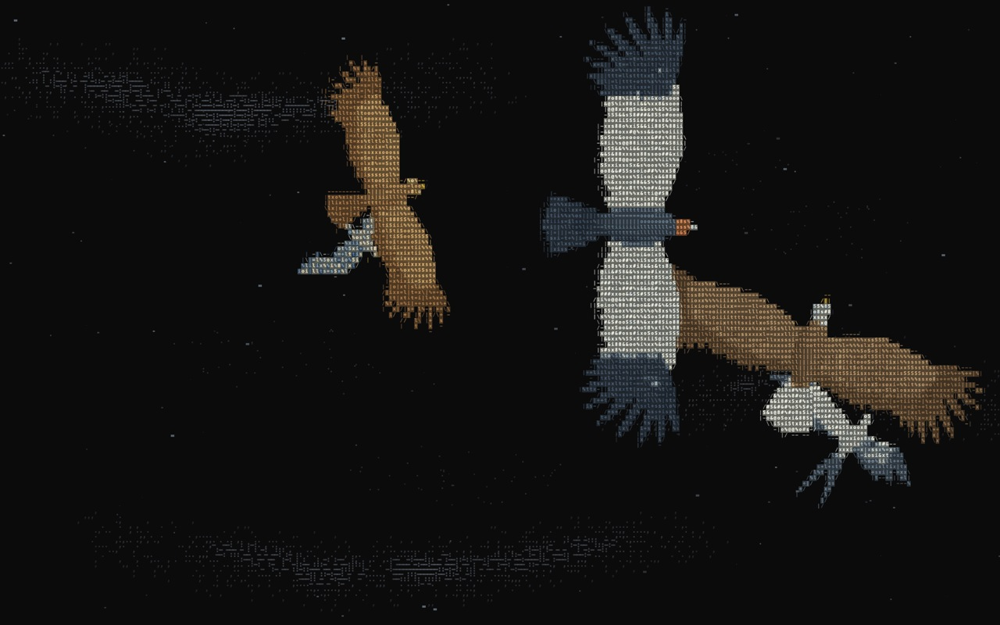

# ascii-raptors

Birds of prey built from articulated geometry, animated procedurally, and drawn with real ASCII characters on Canvas 2D. TypeScript, no runtime dependencies, no framework required.

**[Explore the live sky →](https://rafaeltorres.dev/ascii-raptors/)** · [Open the individual studies](https://rafaeltorres.dev/ascii-raptors/study.html)



[Light theme](docs/media/sky-light.jpg) · [Architecture](docs/ARCHITECTURE.md) · [Validation and limitations](docs/VALIDATION.md)

## What is here

The landing page is a shared sky with five birds, drifting ASCII atmosphere, light/dark themes, and pause/play controls. Birds turn along their routes, bank into curves, and transition between gliding and flapping. The individual study page offers three species, four views, pose inspection, and export tools.

| Bird                | Model                                                                         | Available in        |
| ------------------- | ----------------------------------------------------------------------------- | ------------------- |
| Swallow-tailed kite | Original anatomy, forked tail and articulated wings                           | Sky, study, library |
| Golden eagle        | Original anatomy, broad wings and separated primaries                         | Sky, study, library |
| Peregrine falcon    | Original anatomy, pointed wings and coupled folding                           | Sky, study, library |
| Bald eagle          | Golden-eagle base geometry with demo-specific plumage and head/beak treatment | Sky only            |
| California condor   | Golden-eagle base geometry with demo-specific plumage and head/beak treatment | Sky only            |

**Five appearances, three independently authored anatomical models.** The additional sky birds do not have their own skeletal rigs or library species IDs. The scene's plumage/compositing treatment is separate from the individual studies.

All visible bird marks use a glyph atlas. The sky compositor adds opaque material beneath interior cells to keep the birds solid; partially covered edges retain glyph coverage. There are no bird images, videos or downloaded models in the renderer. The images in this README are captures of the running project.

## Run locally

Use Node.js **22.13+ on the 22.x line, or 24+**, and npm. Node 24 is recommended.

```sh
git clone https://github.com/rafaeltorresng/ascii-raptors.git
cd ascii-raptors
npm ci
npm run dev
```

Open **http://127.0.0.1:5180/**. The server binds to localhost and fails explicitly if the port is occupied. Open **/study.html** for the individual studies, or **/study.html?species=golden-eagle** for a particular bird. The current demo labels are in Portuguese.

```sh
npm run lint          # ESLint, including the TypeScript tests
npm run typecheck     # strict TypeScript checks
npm test              # geometry, pose, composition and regression contracts
npm run build         # demo + ESM library + declarations
npm run verify        # lint, formatting, tests and build
npm run check:demo    # validate the built demo's assets and subpath navigation
npm run pack:check    # inspect the npm package file list without publishing
```

`npm run preview` serves the compiled demo after `npm run build`; stop the development server first because both use port 5180. Generated files live in `dist/demo/` and `dist/lib/`.

## Use the library

The framework-independent `AsciiRaptor` host renders one of the **three original models**. The shared five-bird scene is demo code, not part of the package API. There is no npm release; the package keeps `private: true` to prevent accidental publication.

After building this checkout, another local project can install it with `npm install ../ascii-raptors` and use a bundler:

```ts
import { AsciiRaptor } from 'ascii-raptors';

const canvas = document.querySelector<HTMLCanvasElement>('#bird')!;
const bird = new AsciiRaptor(canvas, {
  species: 'golden-eagle',
  theme: 'dark',
  view: 'ventral',
  mode: 'soar',
});

bird.pause();
bird.renderAt(2, { bank: 0.35 });
bird.setOptions({ species: 'peregrine-falcon' });
bird.play(); // call from an explicit user action when reduced motion is requested
bird.destroy();
```

The host page must give the canvas a CSS size and an accessible description. Importing the package is safe without DOM globals; constructing an instance needs a browser with Canvas 2D, ResizeObserver, IntersectionObserver and matchMedia. Exported types include `RaptorOptions`, `FlightPose` and `SpeciesId`; `SPECIES` exposes the three models' metadata and authored studies.

## Motion and accessibility

Reduced motion starts the scene still until the user explicitly chooses play. The animation suspends when hidden or outside the viewport. Pause and theme preferences persist in sessionStorage and localStorage respectively. Native buttons and form controls expose accessible names; the canvas has a text description without announcing each frame.

The motions are art-directed kinematics, not measured aerodynamic simulations. Wingbeat timing, anatomy, feather mechanics and colors are stylized. Large primaries can still touch the frame on narrow screens, and birds occasionally overlap. Font rasterization, detail and performance vary by browser and device.

The latest visual inspections and timing measurements were made in Chromium. Phone-sized viewports are not physical-device tests; the current shared scene has not been fully validated in Gecko, Safari, assistive readers or on physical phones. See [validation](docs/VALIDATION.md) for exactly what was run and which checks are manual.

## Development

The Node suite protects the approved models, pose samples, transformed geometry and original reference builds. Run the browser harnesses with the development server active:

- `/tests/browser.html`: Canvas rendering, frozen-reference comparisons and lifecycle checks.
- `/tests/demo.html`: controls, pause persistence, layout and axe-core checks.
- `/tests/solidity.html`: interior-cell opacity and ASCII texture in both themes.
- `/tests/motion.html`: timeline, viewport and recording tools for the shared sky.
- `/tests/feathers.html`: individual demo birds and poses in both themes.
- `/tests/performance.html`: warmed-up rendering measurements without per-frame readbacks.

These harnesses are development tools and are excluded from the demo build. GitHub Actions runs the command-line checks on Node 22 and 24; browser and physical-device checks are not automated by that workflow.

## Demo deployment

GitHub Pages serves the existing two-page Vite build. On a push to `main`, both Node jobs must pass before deployment. The Node 24 job uploads only the verified `dist/demo/` output; the deployment job publishes that exact artifact. Pull requests and other branches never deploy. The workflow does not create commits, publish npm packages or modify the portfolio.

The relative `base: './'` keeps assets and study navigation inside `/ascii-raptors/`. `npm run check:demo` checks the generated entry points and their references at both a root URL and a project subpath. To inspect a deployment, open the [Actions run](https://github.com/rafaeltorresng/ascii-raptors/actions/workflows/ci.yml); it can also be rerun manually on `main`.

The Pages project inherits this account's existing `rafaeltorres.dev` domain, so the live URL uses that domain. Its build, artifact and repository are independent of the portfolio. Hosting uses the [official GitHub Pages workflow](https://docs.github.com/en/pages/getting-started-with-github-pages/using-custom-workflows-with-github-pages), with deployment permissions limited to the deploy job.

## Originality and license

Created by Rafael Torres. Original code, geometry and project-generated captures are licensed under [MIT](LICENSE). [ascii-sharks](https://github.com/stackedlol/ascii-sharks) was conceptual inspiration only: no code, assets or models from it are included or licensed by this project. Anatomical references were consulted, not redistributed or traced into assets. System fonts are referenced by name, not bundled.

See [provenance](docs/PROVENANCE.md) for references and dependency-license boundaries, and [contributing](CONTRIBUTING.md) for preserving the visual regression references.
